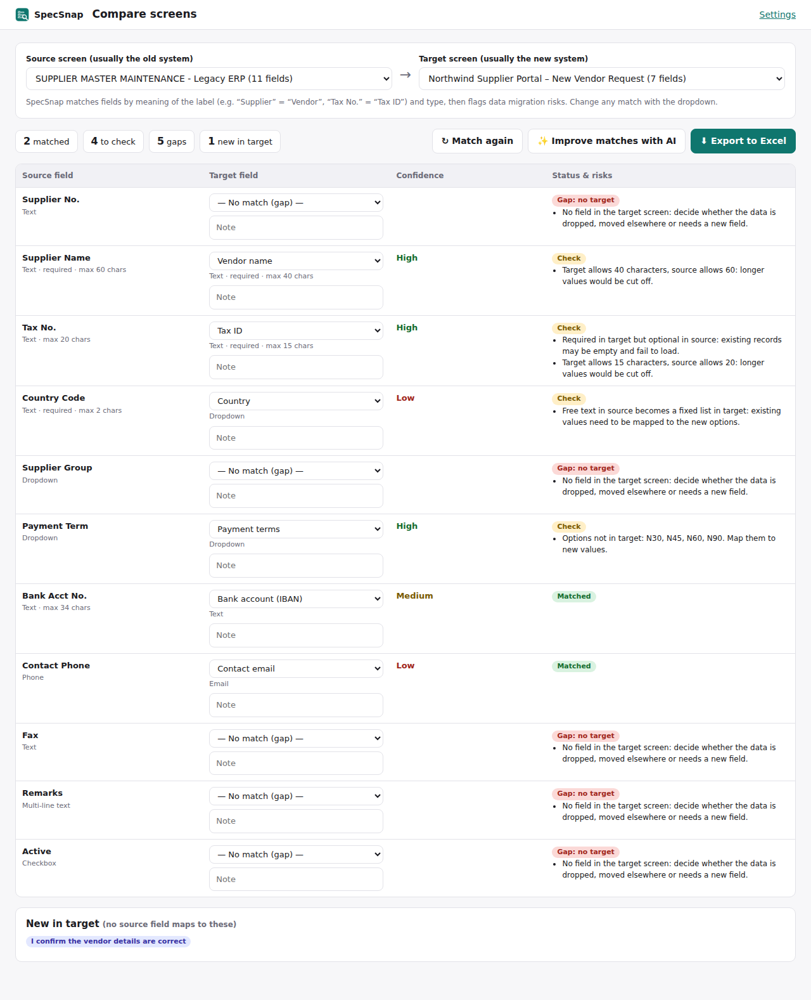

# SpecSnap – Screen to Field Spec

A Chrome extension for business analysts and implementation teams: turn any system screen (forms, list pages, read-only detail pages) into a **field specification** in one click, and **compare old vs new screens** to find data migration gaps and risks.

## Why I built it

When a system is replaced or data is migrated, a BA has to document every screen of the current system: each field, its type, whether it's required, the dropdown values, the length limits. Then the same for the new system, and then map one to the other. It's usually done by hand, screen by screen, into Excel. SpecSnap does the copying so the BA can spend the time on the decisions.

## What it does

1. **Scan a screen.** Open any web page (a form, a list, a record detail page in Salesforce, SAP Fiori or an internal portal) and click *Scan this page*. SpecSnap reads:
   - **input fields** on forms
   - **table columns** on list pages, with example values and the data type they hold (date, amount, number, status…)
   - **displayed values** on read-only detail pages ("Label: value")

   For every field it captures:
   - label and section (from the page's headings and labels, including old table-style layouts)
   - type (text, dropdown, date, checkbox, radio buttons, …)
   - required / read-only
   - max length, number ranges, patterns, placeholder
   - all dropdown and radio options
   - technical field name, help text, current value (sensitive fields are never stored)
   - buttons on the screen
   It also reads inside iframes and web components (e.g. Salesforce Lightning) and takes a screenshot.
2. **Document it.** For each field add a business description, a decision (Keep / Change / Remove / New), a mapping or target field, and notes. Click ◎ to highlight the field on the page.
3. **Compare two screens** (for example the legacy form and its replacement). SpecSnap matches fields by meaning ("Supplier Name" = "Vendor name", "Tax No." = "Tax ID") and flags risks:
   - **Gaps**: source fields with nowhere to go
   - **New in target**: fields nobody provides data for yet
   - **Required in target but optional in source**: records that may fail to load
   - **Length limits**: values that would be cut off
   - **Free text → fixed list** or list values that don't exist in the target
   Change any match with a dropdown and add notes.
4. **AI (optional, your own Claude API key).** Write business descriptions for every field, list questions to confirm with the business, and improve the field matching.
5. **Export**
   - **Excel**: Summary, Field Inventory, Field Mapping (with status and risks), Screens (with screenshots) and Buttons.
   - **Word**: a field specification document, one section per screen with its screenshot and field table (plus the mapping), ready to drop into a requirements document.

## Install (developer mode)

1. Download [SpecSnap.zip](https://xfeng25.github.io/specsnap/SpecSnap.zip) and unzip it.
2. Open `chrome://extensions` and turn on **Developer mode**.
3. Click **Load unpacked** and choose the unzipped **SpecSnap** folder.
4. Pin SpecSnap from the puzzle-piece menu. Clicking it opens the side panel.

## Try it

Two practice screens are included: a legacy ERP supplier screen and its new replacement.

1. Open the legacy screen: https://xfeng25.github.io/specsnap/demo/legacy-supplier.html
2. Open the SpecSnap side panel, allow website access, and click **Scan this page**.
3. Open the new screen: https://xfeng25.github.io/specsnap/demo/new-vendor-portal.html and scan it too.
4. Click **Compare two screens**, review the gaps and risks, then export to Excel or Word.
5. Also try a list + detail page: https://xfeng25.github.io/specsnap/demo/vendor-list.html

## Privacy

- SpecSnap asks for website access the first time you scan (nothing is granted at install) and only reads a page when you click Scan.
- Screens, notes and screenshots stay in your browser. Values of password and other sensitive-looking fields are never stored.
- Data is sent to Anthropic's API only when you use an AI button with your own key.

## How it works

| Part | File | Role |
|---|---|---|
| Scanner | `lib/scanner.js` | Injected on demand; finds labels (aria, `<label>`, table cells, nearby text), sections (legends, headings), types, rules and options; groups radio buttons; builds a selector to highlight each field. |
| Side panel | `sidepanel.*` | Scan, screens list, field notes, locate on page. |
| Matching | `lib/compare.js` | Label similarity with business synonyms, type compatibility, greedy best-match; risk rules for migration. |
| Compare page | `compare.*` | Mapping table with manual overrides and notes. |
| AI | `lib/ai.js` | Claude Messages API: field descriptions, BA questions, semantic matching. |
| Excel | `lib/excel.js` | Five-sheet workbook with ExcelJS. |
| Word | `lib/word.js` | Field specification document with the docx library. |

Manifest V3, plain JavaScript, no build step. Bundles [ExcelJS](https://github.com/exceljs/exceljs) and [docx](https://github.com/dolanmiu/docx) (both MIT).
